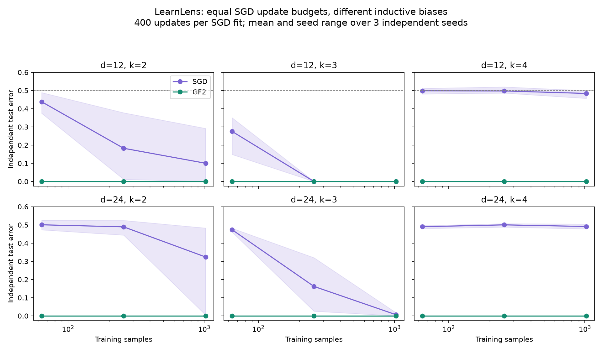

# LearnLens

**A reproducible workbench for studying how data, optimization budget and inductive bias affect learnability.**

[Interactive demo](https://naren-srinivas.github.io/learnlens/) · [Source](https://github.com/naren-srinivas/learnlens) · [Audit](RESEARCH_AUDIT.md) · [Research protocol](RESEARCH_PROTOCOL.md)

LearnLens trains a small neural network with manual NumPy backpropagation, compares it with an exact noiseless-parity solver, and exports results with configuration hashes, source hashes, uncertainty intervals and explicit censoring. The static demo also trains a network directly in your browser. The Python app supports parity, decision lists and truncated-Gaussian halfspaces with four general learners.

This is an empirical research and engineering project. It does not establish a new theorem, a universal learnability predictor, or verified research novelty. The inherited paper is an unreviewed draft with superseded claims; it is not included in the public release. See the audit before using earlier results in an application or manuscript.



## What was actually run

The included benchmark contains **108 model fits**: two dimensions (12, 24), three parity sparsities (2, 3, 4), three training sizes (64, 256, 1024), three data/support/initialization seeds, and two learners.

- Every SGD fit uses **400 updates**, batch size 32, width 32, learning rate 0.1. Fixed epochs would give larger datasets more optimization steps; this benchmark removes that confound.
- The GF2 solver receives only the same training inputs and labels. It does not receive target support or query the target function.
- The exact solver obtained zero error on the 1,000-point independent test sample in all 54 fits. Across this particular grid, SGD's mean test error was 0.32865. This aggregate describes the chosen grid, not a universal performance estimate.
- A validation-only criterion (pointwise 95% Wilson error upper endpoint ≤ 0.15, sustained through larger tested n) produced nine interval crossings and nine right-censored SGD sweeps. All 18 solver sweeps were left-censored at n=64.
- The threshold is a prespecified operational definition. These crossing intervals describe a discrete validation grid; they are not simultaneous confidence intervals for a population phase transition.

The archived JSON includes environment versions, exact configuration and SHA-256 hashes of the scientific source files. The chart's shaded bands show the seed range, not a confidence interval. Three seeds are a demonstration, not adequate evidence for a publication-level universality claim.

## Run locally

Python 3.12 is the tested version. From this repository:

```powershell
python -m venv .venv
.venv/Scripts/python -m pip install -r requirements-dev.txt
.venv/Scripts/python -m pytest tests -q
.venv/Scripts/python -m streamlit run app.py
```

Then open http://localhost:8501. No GPU, API keys or external paid services are required. Browser demo: open `docs/index.html`, or serve it with `python -m http.server 8000 --directory docs`.

```powershell
# Re-run the 108-fit benchmark; saved separately from inherited results
.venv/Scripts/python run_benchmark.py
.venv/Scripts/python export_site.py

# Execute the actual notebook and save its outputs
.venv/Scripts/python execute_notebook.py
```

`LearnLens_Colab.ipynb` now uses the same benchmark implementation. Upload the release ZIP as `learnlens.zip` alongside the notebook, or run it from the cloned repository. Its seven cells executed successfully in a local Python kernel. Hosted Google Colab has not been independently checked.

For additional seeds use `python run_benchmark.py --seeds 10 --output outputs/benchmark_10seeds.json`. For different dimensions, grids or compute budgets, call `learnlens.benchmark.run_benchmark` directly. Commit config and results together; do not choose thresholds after examining test outcomes.

## What the diagnostics mean

| Diagnostic | Access and interpretation |
| --- | --- |
| Test error + Wilson interval | Independent test draw; pointwise uncertainty conditional on a trained model |
| Learnability Index | Heuristic, post-hoc score containing test error; not a pre-training predictor |
| Random-label correlation | Fits the chosen algorithm to random labels; lower approximation to the Rademacher supremum, not a certified capacity bound |
| Fourier leap | Oracle-assisted Boolean diagnostic; counterfactual target queries and support metadata are not ordinary labeled-data access |
| NTK alignment | Exact finite-width manual parameter Jacobian at initialization; optional centering checks label-imbalance sensitivity |
| PAC-Bayes | Gaussian Gibbs classifier bound with prior-grid union correction and Monte Carlo risk uncertainty; does not certify deterministic network error |
| Grid transition | Interval, left-censored or right-censored; unobserved transitions are never replaced by artificial exact n values |

The corrected leap implements the **union** of previously discovered Fourier supports from Abbe et al. (2023), rather than a nested chain. The PAC-Bayes variance grid must be fixed before observing the training data. “Non-vacuous” means bound < 1; “beats balanced chance” means < 0.5. Small Monte Carlo budgets often produce vacuous bounds honestly.

## Deployment

The static site in `docs/` has a real in-browser trainer and embedded measured benchmark data. GitHub Pages hosts this without Python infrastructure. `.github/workflows/pages.yml` deploys it after Pages is configured to use GitHub Actions. It does not host the Streamlit backend.

To host the Python app on Streamlit Community Cloud, choose repository `naren-srinivas/learnlens`, branch `main`, entrypoint `app.py`, and Python 3.12. No secrets are needed. A Dockerfile is included for other hosts; its build has not been verified locally because Docker is unavailable.

Deployment references: [GitHub Pages workflow documentation](https://docs.github.com/en/pages/getting-started-with-github-pages/using-custom-workflows-with-github-pages), [Streamlit deployment documentation](https://docs.streamlit.io/deploy/streamlit-community-cloud/deploy-your-app).

## Verification

- **41 passing tests**, including 13 live app problem/learner paths and the d/k control regression.
- Finite-difference verification of the manual NTK Jacobian, exact parity recovery on unseen data, rank deficiency and inconsistent parity equations, non-nested leap support, fixed optimizer updates, confidence intervals and censoring.
- Seven-cell notebook executed end to end; executed copy in `outputs/LearnLens_executed.ipynb`.
- Local Streamlit health endpoint returned `ok`.
- GitHub Actions passed the Python/app checks on Linux; local Windows checks also passed.
- Public GitHub Pages deployment verified, including live browser training and benchmark filter interactions. The Python-backed Streamlit app remains local/deployment-ready.

See `RESEARCH_AUDIT.md` for limitations and `VALIDATION.md` for deployment/browser status. `requirements-lock.txt` records the Windows verification environment; portable top-level dependencies remain in `requirements.txt`.

## Research foundations and next contribution

- Abbe, Boix-Adsera and Misiakiewicz, [Merged-staircase property](https://proceedings.mlr.press/v178/abbe22a.html), COLT 2022.
- Abbe, Boix-Adsera and Misiakiewicz, [Leap complexity and saddle-to-saddle dynamics](https://proceedings.mlr.press/v195/abbe23a.html), COLT 2023.
- Lyu, Jia, Cai and Zhu, [Transformers with RL or SFT Provably Learn Sparse Boolean Functions, But Differently](https://arxiv.org/abs/2511.17852), first posted 2025; ICML 2026 final version.

A concrete next study is to test whether cheap, sample-only diagnostics forecast *budget-conditioned* learning thresholds on held-out dimensions and target families, and whether intermediate supervision changes those thresholds. The transformer paper supplies a recent motivation; this repository does not yet implement or reproduce that transformer result. Novelty must be established by a broader literature review and controlled experiments. The proposed protocol separates oracle ablations, validation selection and untouched test evaluation.

MIT license. Please cite the actual methods and report your configuration and limitations when reusing this work.
